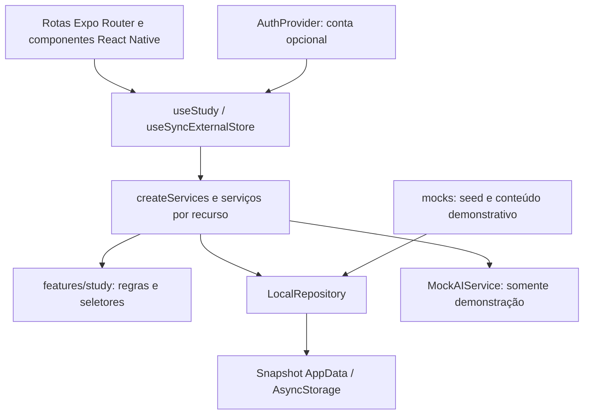

# Cortexa — auditoria da arquitetura e evolução longitudinal

Data: 18 de outubro de 2026. Escopo: auditoria, arquitetura proposta e plano de migração. **A implementação da primeira fase não foi iniciada.**

## 1. Parecer

O Cortexa já possui uma base local de aprendizagem que deve ser preservada. Há prática adaptativa por conceito, confiança antes do feedback, estimativa de domínio, revisão conceitual, caderno de erros, simulados com correção na entrega, autoria manual, biblioteca e isolamento entre espaços. Reconstruir essas funções introduziria duplicação e risco desnecessários.

O principal limite é a ausência de uma representação acadêmica comum a todas as atividades. O perfil conhece semestre, curso, universidade, objetivo livre e disciplinas; não conhece etapa da formação, ingresso ou transições. As evidências estão distribuídas entre tentativas, revisões, sessões e conversas. Além disso, coexistem regras distintas de domínio por assunto e por conceito.

A direção recomendada é adicionar Academic Journey e uma projeção do Learner Model sobre as entidades existentes; depois unificar a entrada de evidências com Study Events e evoluir o motor atual. Avaliações nacionais entram como configuração versionada desse núcleo. Integração com IA e sincronização remota não devem ser pré-requisitos para essa fundação.

## 2. Método e limites

Foram inspecionados os arquivos de configuração, contratos, tipos, providers, regras, serviços, fixtures, rotas, componentes relevantes, documentação e testes. A análise considera o **estado atual do diretório de trabalho**, que já continha muitas alterações e arquivos não rastreados antes desta auditoria. Isso inclui partes importantes da prática e do estúdio; não se presume que já estejam preservadas em um commit.

O diagnóstico combina leitura estática, execução das verificações existentes e três sondagens temporárias em repositórios em memória. As sondagens não acessaram os dados de estudo do usuário. O Expo já estava rodando em `http://localhost:8081`, em modo offline, e foi reutilizado. As capturas preexistentes foram copiadas antes dos E2E para permitir sua restauração após os testes.

Não foram consultados dados de pacientes, adicionadas credenciais, modificados serviços externos nem criadas tabelas. A existência de um cliente Supabase no código não comprova a existência ou configuração de um backend remoto. Nesta auditoria, não havia `.env.local` ou `.env` no projeto; foi encontrado apenas `.env.example`.

## 3. Arquitetura atual

### 3.1 Framework, dependências e configuração

| Item             | Estado constatado                                                                                                 |
| ---------------- | ----------------------------------------------------------------------------------------------------------------- |
| Aplicação        | Expo `~54.0.33`, React Native `0.81.5`, React `19.1.0`                                                            |
| Linguagem        | TypeScript `~5.9.2`, `strict: true`, alias `@/*`                                                                  |
| Navegação        | Expo Router `~6.0.23`, entrada `expo-router/entry`, rotas tipadas                                                 |
| Persistência     | AsyncStorage `2.2.0`, snapshot JSON por espaço                                                                    |
| Conta opcional   | `@supabase/supabase-js` `2.118.0`, versão fixada                                                                  |
| Interface        | Componentes React Native; React Native Web no navegador; Inter, ícones Expo, Animated, safe areas, blur e haptics |
| Testes de lógica | `node:test`, executado com `tsx`; sem Jest                                                                        |
| E2E              | Playwright/Chromium, um worker, base `localhost:8081`; o servidor não é iniciado pela configuração Playwright     |
| Qualidade        | ESLint com rejeição de `any` explícito; Prettier; exportação Expo                                                 |
| Alvos            | iOS, Android e web; suporte a tablet declarado; orientação global `portrait`; nova arquitetura habilitada         |

Evidências: [package.json](../package.json), [tsconfig.json](../tsconfig.json), [app.json](../app.json), [playwright.config.ts](../playwright.config.ts), [eslint.config.js](../eslint.config.js).

Não há dependência de SDK de LLM, gravação de áudio, OCR ou leitura de PDF implementada. A arquitetura atual não exige alterações de dependências nativas para começar a evolução longitudinal.

### 3.2 Camadas reais



- `app/`: rotas e composição de experiências, incluindo algum estado de fluxo e cálculo de apresentação.
- `components/`: sistema visual, navegação, documentos, perfil, gráficos e prática.
- `types/domain.ts`: entidades gerais e snapshot; `types/practice.ts`: contratos de prática; `types/studio.ts`, `types/insights.ts` e `types/search.ts`: tipos especializados.
- `features/study/`: seleção/priorização, domínio, agenda, progresso, calendário, busca e transformação mecânica de texto.
- `services/`: composição, comandos de atualização, persistência, perfil, materiais, prática, estúdio, autenticação e efeitos hápticos.
- `mocks/`: dados e respostas da demonstração. Parte da navegação de produção também está nesse diretório.
- `constants/`: identidade visual, ferramentas, rótulos, catálogo curricular e parâmetros de movimento.

Há separação útil entre regras e efeitos, mas não há um domínio longitudinal independente nem um backend de aprendizagem implementado. Não é necessário criar uma segunda árvore `domain/` nem reorganizar todas as rotas para obter essa separação.

### 3.3 Estado global e persistência

`AuthProvider → StudyProvider → AppearanceProvider → NavigationLayoutProvider → MotionProvider → navegação` é a composição observada em [app/\_layout.tsx](../app/_layout.tsx).

| Estado                   | Proprietário / persistência                                                            |
| ------------------------ | -------------------------------------------------------------------------------------- |
| Dados de estudo          | `LocalRepository`, exposto por `useStudy` com `useSyncExternalStore`                   |
| Demonstração             | `cortexa:demo:v1`; ausência de `workspace` em snapshots antigos significa demonstração |
| Espaço pessoal sem conta | `cortexa:personal:local:v1`, começa vazio                                              |
| Espaço de conta          | `cortexa:personal:<auth-user-id>:v1`; continua local mesmo após login                  |
| Escolha de espaço        | `cortexa:workspace`; conta autenticada força espaço pessoal                            |
| Aparência                | `cortexa:appearance:v1`; preferência global do dispositivo                             |
| Navegação                | `cortexa:navigation-layout:v1` e `cortexa:navigation-collapsed:v1`                     |
| Movimento e lembretes    | Preferências no snapshot; redução de movimento também respeita o sistema               |
| Formulários e painéis    | Estado React local, geralmente sem recuperação de rascunho                             |
| Prática em andamento     | Sessões persistidas com respostas, confiança, índice, marcações, pool e tempo          |

A troca de identidade remonta o espaço e sua navegação. A troca manual aguarda `flush()`. A fila de escrita é serializada; a atualização em memória e a notificação dos componentes acontecem antes da gravação. Um snapshot recusado bloqueia sobrescrita automática. Há validação de versão, modo e proprietário, além de validação mais detalhada para estúdio e prática.

Isso oferece uma base para compatibilidade, mas não transações duráveis, criptografia, sincronização entre dispositivos ou resolução de conflitos. A fila é por instância: duas abas não compartilham controle de concorrência. O último snapshot gravado pode sobrescrever a alteração da outra aba.

Evidências: [hooks/useStudy.tsx](../hooks/useStudy.tsx), [services/repository.ts](../services/repository.ts), [services/personalWorkspace.ts](../services/personalWorkspace.ts), [hooks/useAppearance.tsx](../hooks/useAppearance.tsx), [hooks/useNavigationLayout.tsx](../hooks/useNavigationLayout.tsx).

### 3.4 Backend, integrações e IA

**Supabase:** há configuração pública opcional, armazenamento de sessão, `processLock`, validação com `auth.getUser`, assinatura de eventos e controle de renovação por AppState. Sem configuração, o cliente é `null`. `publicAuthConfig` aceita URL HTTPS e chave publicável, recusando chaves secretas como configuração pública. A tela de conta chama diretamente `supabase.auth.signUp`, `signInWithPassword` e logout; é uma exceção à camada de serviços pretendida.

Não foram encontrados migrações SQL, adapter remoto de aprendizagem, políticas RLS, buckets, funções remotas ou sincronização. Os testes de dois proprietários usam repositórios locais e não demonstram autorização no servidor. Uma falha de validação da conta resulta em `user: null`; o comportamento de continuidade offline de uma conta ainda precisa ser especificado e testado.

**IA:** `MockAIService` monta respostas por palavras e conteúdo pronto, espera 600 ms e persiste conversas demonstrativas. Há referências específicas a `raas`, `potassium` e ao primeiro assunto disponível. O serviço não consulta evidência individual de dificuldade, estágio ou competências. O espaço pessoal recusa o envio tanto na UI quanto no serviço. A espera é simulação de interação, não inferência remota.

**Contratos futuros:** `AIRouter`, `AITask`, `RetrievalService` e `IngestionService` já existem em [services/contracts.ts](../services/contracts.ts). O router demonstrativo diferencia capacidades e retorna `provider: 'mock'`; não é um roteador multimodelo operacional. Faltam contratos de modelo/provedor, orçamento, requisição, uso, saída validada, fallback e telemetria. `PracticeContentProvider` já permite substituir a obtenção local de conteúdo e é um ponto de extensão a preservar.

**Fontes:** `StudySource` reúne materiais, estúdio, conversas, cartões e quizzes a partir do snapshot. Na prática pessoal, o vínculo com questões precisa ser explícito; não se declara que um PDF foi lido apenas porque o assunto coincide. Citações da demonstração são identificadas. Ainda não existe registro persistente de trechos com versão de documento, hash, página/timestamp verificado e vínculo a conceitos.

Evidências: [services/authConfig.ts](../services/authConfig.ts), [services/supabase.ts](../services/supabase.ts), [hooks/useAuth.tsx](../hooks/useAuth.tsx), [app/account.tsx](../app/account.tsx), [services/mockAI.ts](../services/mockAI.ts), [services/practice.ts](../services/practice.ts).

## 4. Funcionalidades e rotas: estado real

| Área / rotas                                        | O que funciona                                                                                                                      | Limite atual                                                                                                                           |
| --------------------------------------------------- | ----------------------------------------------------------------------------------------------------------------------------------- | -------------------------------------------------------------------------------------------------------------------------------------- |
| Conversar — `/`, `/ai`                              | UI de conversa, nova conversa, modos aula/medicina, contexto por material/assunto, resposta e fonte demonstrativas                  | `/` reexporta a tela de `/ai`; IA pessoal bloqueada; rascunho pessoal em `useState` não é histórico persistido                         |
| Visão geral — `/overview`                           | Home separada para demonstração/pessoal, calendário, meta, prioridades, materiais e provas                                          | O CTA pessoal privilegia a última sessão/material; não considera etapa acadêmica nem uma política única de recomendação                |
| Estudar — `/study`                                  | Acesso a prática, casos, cards, erros, planejamento e revisão de véspera                                                            | Ainda apresenta ferramentas como entradas distintas; configuração de navegação vem parcialmente de `mocks/navigation.ts`               |
| Questões — `/questions`                             | Preparação antes da sessão, continuidade, pontos fracos, fontes, texto novo, assunto, diagnóstico, dificuldade, estilo e quantidade | Banco local/manual; não gera questões inéditas nem considera etapa da formação                                                         |
| Prática — `/practice/[id]`                          | Resposta comprometida, confiança antes do gabarito, alternativas comentadas, remediação, intercalação, pausa/retomada e resultado   | Domínio heurístico; sem tempo individual por questão, objetivo pedagógico estruturado ou histórico acadêmico do evento                 |
| Simulados — `/questions?kind=exam`                  | Banco montado antes do início, marcações, navegação, rascunhos e correção somente na entrega; prazo absoluto opcional               | Não há blueprint de exame, matriz oficial ou certificação segura; as respostas estão no cliente                                        |
| Erros — `/mistakes`                                 | Agrupamento por conceito, resposta dada/correta, confiança, recorrência, hipótese do banco, revisão posterior e nova prática        | Não guarda domínio antes/depois por erro, estágio ou causa individual validada; revisões contadas principalmente por novas tentativas  |
| Flashcards — `/flashcards`                          | Autoria manual, criação a partir de questão, giro, avaliação e agenda persistida                                                    | Vínculo direto é por assunto/questão; revisão não alimenta `ConceptMastery` nem a fila conceitual                                      |
| Leitura — `/session`, `/topic/[id]`                 | Texto do material/assunto, pontos principais, ações de prática e registro de conclusão/minutos                                      | Texto pessoal é anotação literal, não resumo de IA; tempo de leitura inclui background; `12 MIN` é sugestão fixa                       |
| Conhecimento — `/knowledge`                         | Filtros por disciplina, acertos/erros, assuntos avaliados e não avaliados                                                           | O título diz “Domínio por conceito”, mas a lista usa `Topic` e `KnowledgeMetric`, não os conceitos finos da prática                    |
| Biblioteca — `/library`                             | Anotações, pastas com cor, favoritos, busca, filtros, organização e abertura                                                        | O catálogo pessoal tem cinco disciplinas fixas; não há CRUD curricular amplo, upload ou extração                                       |
| Materiais — `/material/add`, `/material/[id]`       | Texto próprio associado a disciplina/assunto/pasta, origem e acessos derivados                                                      | PDF, slides enviados, imagens, links e áudio não são ingeridos; arquivos demonstrativos não têm arquivo real                           |
| Autoria — `/compose`                                | Questão com quatro alternativas, gabarito, explicação, dificuldade, conceito opcional e fontes; cartão manual                       | Sem revisão médica/AI Judge; distratores recebem comentário padrão; fontes não são verificadas semanticamente                          |
| Estúdio — `/studio`, `/studio/edit`, `/studio/[id]` | Texto colado, edição/exclusão, mapa e slides, cópia entre formatos, zoom e persistência                                             | Apenas formatação mecânica por blocos; mapa não é grafo de conhecimento; não há transcrição automática nem geração semântica           |
| Histórico — `/history`                              | Reabrir conversas locais da demonstração por última mensagem                                                                        | Não é uma linha do tempo unificada de aprendizagem; IA pessoal não produz conversas persistidas                                        |
| Tutor — `/tutor`                                    | Roteiro fictício guiado, feedback e placar transitório                                                                              | Hardcode de ácido-base; respostas não entram em tentativas, domínio ou calendário; indisponível no pessoal                             |
| Provas — `/exams`                                   | Cadastro e remoção de prova com data, disciplina e assuntos                                                                         | `Exam` é compromisso acadêmico, não definição de exame nacional; não há competências ou versão de regulamento                          |
| Plano — `/planner`                                  | Orçamento diário, prazo, assuntos e plano local; revisão de véspera                                                                 | Ranking por assunto e distribuição repetida ao longo dos dias; sem conclusão por bloco, replanejamento longitudinal ou etapa acadêmica |
| Perfil — `/profile`, `/profile-edit`                | Curso, semestre, universidade, objetivo, disciplinas, disponibilidade e preferências                                                | Perfil e estatísticas compartilham `User`; etapa e ingresso não existem                                                                |
| Onboarding — `/onboarding`                          | Três telas introdutórias puláveis e formulário compartilhado com edição                                                             | Universidade opcional; objetivo e ao menos uma disciplina são exigidos; não há “ainda não sei” para etapa ou ingresso                  |
| Conta — `/account`                                  | Fluxo cliente de e-mail/senha condicional à configuração; ausência de serviço é informada                                           | Sem ambiente remoto validado; Apple/Google apenas explicam indisponibilidade                                                           |
| Plus — `/membership`                                | Prévia com seleção de período e retorno                                                                                             | Sem preço real, cobrança, direitos premium, créditos ou restauração de compras                                                         |
| Lembretes, aparência, navegação                     | Preferências locais; tema claro/escuro; redução de movimento; layouts inferior/lateral e painéis reutilizáveis                      | Não agenda push; testes Chromium não comprovam gestos, teclado ou feedback háptico nativos                                             |
| Recuperação de rota — `+not-found`                  | Retorno quando o destino não existe                                                                                                 | Não substitui tratamento de falhas de serviço por recurso                                                                              |

Preservar Expo Router e os caminhos atuais. `/ai` é uma rota oculta das abas e `/` usa a mesma implementação: isso é alias, não justificativa para construir um segundo chat.

## 5. Dados existentes e correspondência com a visão

| Conceito desejado    | Equivalente atual                                                                     | Evolução necessária                                                                                                   |
| -------------------- | ------------------------------------------------------------------------------------- | --------------------------------------------------------------------------------------------------------------------- |
| Usuário / perfil     | `User`, `AcademicProfile`                                                             | Adicionar jornada sem copiar estatísticas nem duplicar perfil                                                         |
| Academic Journey     | Sem entidade; semestre e dados básicos em `User`                                      | Etapa declarada, ingresso com precisão, contexto atual e transições confirmadas                                       |
| Learner Model        | Projeções parciais: `studentContext`, progresso, métricas e prática                   | Uma projeção tipada comum, com proveniência, ausência de evidência e contexto temporal                                |
| Disciplina / tema    | `Subject → Topic`; `unit` é texto                                                     | Subtópicos e relações explícitas sem alterar IDs existentes                                                           |
| Conceito             | `PracticeConcept`, derivado das questões; `conceptId` opcional                        | Registro independente de questões; identidade estável e relações tipadas                                              |
| Pré-requisito        | `Question.prerequisiteConceptId`                                                      | Relação entre conceitos, podendo haver múltiplas arestas                                                              |
| Questão / tentativa  | `Question`, `QuestionAttempt`                                                         | Especificação pedagógica, versão da questão, tempo, fontes e estágio no momento da tentativa                          |
| Confiança            | `certain`, `unsure`, `guess`                                                          | Preservar; distinguir ausência de informação em histórico antigo                                                      |
| Domínio              | `ConceptMastery` e `KnowledgeMetric`                                                  | Uma política de evidência; métricas por assunto como projeções; versão do algoritmo                                   |
| Histórico de domínio | Tentativas e `session.masteryBefore`                                                  | Registro de evolução por evento/versão; não tratar o valor recalculado hoje como valor histórico exato                |
| Revisão              | `ConceptReviewSchedule`, `Flashcard`, `FlashcardReview`                               | Coordenar agendas conceituais e de cartões, preservando seus significados diferentes                                  |
| Erro                 | `Mistake`                                                                             | Contexto acadêmico, evidência de recorrência e domínio antes/depois                                                   |
| Material / fonte     | `StudyMaterial`, `StudioDocument`, `StudySource`, citações                            | Proveniência persistente e versionada, trechos verificáveis e vínculo a conceitos                                     |
| Sessão               | `StudySession`, `PracticeSession`                                                     | A primeira registra atividade/tempo; a segunda executa prática. Relacionar, sem criar uma terceira sessão equivalente |
| Recomendação         | `recommendTopics`, `practiceWeakConcepts`, `PracticeRecommendation`, `studentContext` | Política comum que justifica prioridades por conceito, estágio, objetivo e avaliação                                  |
| Avaliação            | `Exam`, `PracticeMode.exam`, `diagnostic`                                             | `AssessmentFramework`, estágios, blueprint e competências desacoplados                                                |
| Objetivo             | `User.goal` como string, `Exam` com prazo                                             | Objetivos estruturados com contexto de avaliação; manter texto atual durante migração                                 |
| Study Event          | Nenhum contrato comum                                                                 | União discriminada de eventos e processamento idempotente                                                             |
| Aula / áudio         | `StudioDocument.kind = transcript` com texto                                          | Sessão de gravação, adapter STT, timestamps, correção e ingestão reais                                                |
| IA / uso / custo     | Contratos parciais e mock                                                             | Provider/router de servidor, requisições, validação e registros de uso                                                |

O `KnowledgeMetric` é **por assunto**, apesar do uso da palavra “conceito” em parte da UI e documentação. `PracticeConcept` já existe: criar outra entidade `Concept` com IDs novos e abandonar esses vínculos seria uma migração destrutiva disfarçada.

## 6. Dívida técnica e riscos priorizados

### 6.1 Problemas reproduzidos ou diretamente demonstráveis

| Prioridade | Achado e evidência                                                                                                                                                                                                                                           | Impacto / ação recomendada                                                                                                                                                                                              |
| ---------- | ------------------------------------------------------------------------------------------------------------------------------------------------------------------------------------------------------------------------------------------------------------ | ----------------------------------------------------------------------------------------------------------------------------------------------------------------------------------------------------------------------- |
| Alta       | [services/index.ts](../services/index.ts), `questionService.answer`, aplica `+3/-4` ao assunto; `flashcardService.review` aplica `-2/+1`; [services/practice.ts](../services/practice.ts), `recordAttempt`, calcula domínio por conceito e agrega ao assunto | Rotas atuais usam a prática nova; o contrato antigo segue exportado e usado em testes. Unificar a entrada de evidências antes de conectar novos recursos; não remover o legado sem adaptação e regressões               |
| Alta       | Sondagem em memória: após resposta no serviço antigo, assunto = 45 e conceito calculado = 59; avaliar o cartão com `again` levou o assunto a 43, mantendo conceito = 59 e agenda conceitual vazia                                                            | Flashcards e questões não compartilham uma memória conceitual efetiva. Usar eventos distintos com pesos adequados; autoavaliação de cartão não equivale automaticamente a acerto objetivo                               |
| Alta       | [services/repository.ts](../services/repository.ts), `hydrate`, verifica arrays gerais e faz cast para `AppData`; a sondagem aceitou `topics: [{ id: 'malformed-topic' }]` com `storageError: false`                                                         | Tipagem estrita não valida JSON. Validar entidades e referências ao hidratar; preservar o conteúdo recusado e impedir sobrescrita                                                                                       |
| Alta       | `flush()` resolve mesmo quando `setItem` falha; sondagem confirmou `storageError: true` e estado alterado apenas em memória                                                                                                                                  | Várias telas verificam a flag, outras anunciam conclusão/organização após apenas o comando. Formalizar resultado de persistência e aplicar de modo uniforme; não afirmar durabilidade a partir de um `await` do serviço |
| Média      | Expo Doctor: `android.adaptiveIcon.foregroundImage` usa `assets/cortexa-mark.png` de 1321×1191                                                                                                                                                               | Asset não quadrado; 17/18 verificações passaram. Corrigir o asset/configuração em incremento específico, preservando a marca                                                                                            |
| Média      | `format:check` falha em 13 arquivos; `npm audit` retorna 39 alertas: 16 moderados e 23 altos                                                                                                                                                                 | Tratar formatação separadamente e avaliar dependências por caminho/alcance. Não executar atualização nativa ou `audit fix --force` como parte da fundação acadêmica                                                     |

### 6.2 Limites estruturais

1. **Identidade conceitual depende do conteúdo.** `practiceConcepts` deriva conceitos do banco; o fallback é `topicId`. A autoria gera ID a partir do assunto e nome normalizado. Renomear o conceito ao editar uma questão pode criar outra identidade, deixando histórico/agenda anterior sem continuidade. Evoluir para IDs persistentes e aliases explícitos.
2. **Histórico depende parcialmente do banco atual.** Tentativas antigas podem não ter `conceptId`, nível ou tópico; o cálculo os recupera da questão atual. Edição do banco pode mudar a interpretação passada. As sessões congelam questões, o que é positivo, mas a projeção de domínio ainda consulta o banco global. Registrar identidade/versão e contexto no evento, sem inventar metadados ausentes no legado.
3. **Domínio armazenado e recalculado coexistem.** `practice.mastery` guarda a última estimativa atualizada; `estimateConceptMastery` recalcula com a data atual. `metrics` guarda agregados por assunto que outras rotas alteram. Tratar persistidos como projeções versionadas, com instante de cálculo e regra de reconstrução.
4. **Memória de erros incompleta.** Há agrupamento e confiança, mas não fotografia de domínio por erro ou contexto acadêmico. Causas são hipóteses do banco ou texto manual, não inferências individuais confirmadas.
5. **Não há grafo independente.** `unit`, conceito e subtópico não formam hierarquia tipada. Mapa visual do estúdio organiza texto; não implementa relações `PART_OF`, `RELATED_TO` ou `ASSESSED_BY`.
6. **Parâmetros espalhados.** Há limiares de 50, 65, 70, 75 e 90 em diferentes seletores/telas; parte pode refletir intenções distintas, mas não há política nomeada/versionada que as explique. Recência, pesos, intervalos e XP também estão no código.
7. **Escala longitudinal limitada pelo snapshot.** Todas as entidades, texto de conversas e pools de questões são serializados em cada atualização, inclusive ticks de prática. `useStudy` assina o snapshot inteiro. Há buscas e estimativas repetidas em loops/ordenações. Isso é risco de crescimento, não uma medição de lentidão atual. Introduzir projeções, índices e gravação agrupada quando a memória longitudinal aumentar.
8. **Relógio e contexto não são uniformes.** Leitura usa tempo desde abertura, inclusive background; prática considera foco/AppState e simulados usam prazo absoluto. Falta tempo por resposta. Sessão multitema é resumida em `StudySession` com o primeiro tópico, limitando atribuição posterior de tempo.
9. **Composição ainda acopla dados demonstrativos.** `LocalRepository` importa `createSeed` como padrão; `services/index.ts` exporta também repositório/serviços globais, embora a aplicação injete instâncias por espaço. Remover essas exportações após confirmar consumidores evita futuros usos acidentais fora do provider.
10. **Mocks misturam conteúdo e configuração.** `mocks/navigation.ts` é importado por telas reais e contém ferramentas, rota de revisão com `acid` e sugestões médicas específicas. A tela de estudo remove o assunto fixo no modo pessoal, mas o acoplamento continua. Mover navegação geral para `constants/` e manter sugestões fictícias em fixtures.
11. **Catálogo duplicado e limitado.** As cinco disciplinas aparecem em `constants/subjects.ts` e `mocks/topics.ts`. Não há criação de disciplinas, módulos ou rotações clínicas. Separar catálogo configurável de currículo do aluno sem povoar o pessoal com conteúdo fictício.
12. **UI e orquestração concentram responsabilidades.** Biblioteca e preparação são extensas; há estados semelhantes de `busy/error/flush` em vários fluxos. Separar comandos e hooks de fluxo somente quando houver uma responsabilidade concreta a extrair; preservar componentes visuais compartilhados.
13. **Tema depende de estado de módulo.** `colors` é um Proxy sobre paleta mutável. Funciona na composição atual, mas exige cuidado com memoização de estilos e cores. Há cores literais em componentes. Não é motivo para redesenho na primeira fase.
14. **UX inicial privilegia conversa.** A raiz abre o chat, indisponível para IA no espaço pessoal. A visão longitudinal está em `/overview`. Evoluir o próximo passo nesse espaço e avaliar a entrada inicial em uma fase posterior, sem mudar a navegação arbitrariamente agora.
15. **Promessa de persistência do rascunho é imprecisa.** O chat pessoal usa texto “Pergunta salva apenas neste dispositivo”, mas `draft` está apenas em `useState` e o envio é bloqueado antes de persistir. Corrigir a mensagem ou implementar rascunho local explícito em incremento próprio.
16. **Documentação registra fases diferentes.** `architecture.md` ainda contém afirmação antiga de que tema escuro não existe, seguida da implementação de `AppearanceProvider`; descreve limiares de navegação anteriores. `verification.md` mantém contagens de 26 testes e 18 E2E, diferentes do inventário atual. Atualizar a documentação por comportamento consolidado após a auditoria.

O objetivo livre de `User.goal` aparece na apresentação da home, mas não é usado como entrada pedagógica pelos seletores atuais de questões ou planejamento. O semestre entra em `studentContext`, sem alterar a política da prática. Assim, preservar esses campos não equivale a já possuir adaptação por jornada ou objetivo.

### 6.3 Lacunas de validação

Os testes cobrem regras e fluxos importantes, porém não demonstram autenticação remota, RLS, upload, geração médica ou uso no Expo Go físico. E2E são Chromium com viewports; isso não equivale a Safari/iPadOS ou execução nativa. Faltam regressões específicas para evidência cruzada entre cards/questões, registros internos incompletos, duas abas, evolução de schema, questão editada após tentativa e futuro estágio acadêmico. Não se deve exigir essas novas features como se já tivessem sido implementadas, mas elas precisam de critérios antes de entrar em produção.

Foi encontrada uma falha na suíte atual em `tests/e2e/workspace.spec.ts:64`: `getByText(/Boa (noite|tarde), Victor|Bom dia, Victor/)` encontra duas saudações após navegar da conversa para a visão geral e produz `strict mode violation`. O contexto registrado mostra a saudação da conversa sob um ancestral `aria-hidden` e a saudação da visão geral ativa. A evidência aponta para ambiguidade do locator entre abas montadas, não para duas saudações necessariamente visíveis. A correção proposta é restringir a busca à tela ativa ou usar `.filter({ visible: true })`, preservando a verificação de unicidade; não escolher simplesmente o primeiro resultado. O trecho posterior desse cenário, que retorna ao espaço pessoal, não fica validado enquanto a asserção impedir o avanço. Nenhum teste foi alterado para fazer a auditoria passar.

## 7. O que preservar

- Expo SDK 54, React Native, TypeScript estrito, Expo Router e execução sem credenciais.
- Separação entre demonstração, espaço pessoal local e proprietário autenticado; conteúdo pessoal começa vazio.
- `createServices(repo)`, `Repository`, `StorageAdapter` e composição por espaço. Evoluir contratos, mantendo injeção em testes.
- `Question`, `QuestionAttempt`, `Confidence`, `PracticeSession`, `StudySession`, `Mistake` e IDs históricos.
- `PracticeContentProvider`, pool congelado por sessão, idempotência por sessão/questão e atualização conjunta de tentativa/erro/agenda na prática.
- Preparação de questões, confiança antes do gabarito, feedback formativo, casos progressivos, diagnóstico e separação entre aprender e avaliar.
- Revisão por conceito e remediação por pré-requisito existentes; melhorar política e integração, sem reimplementar o mecanismo do zero.
- Biblioteca, notas literais, pastas, favoritos, busca isolada por espaço, fontes explícitas e estúdio local honesto sobre seus limites.
- `Screen`, `Card`, `Button`, `Field`, `T`, `Notice`, `Empty`, `Choice`, `BottomSheet`, componentes de movimento e navegação.
- `ProfileForm` compartilhado, `PersonalHome`, `StudyCalendar`, `AccuracyChart`, `ReviewPriorities`, `WeeklyGoalIndicator` e `StudyDocumentView` como superfícies de integração.
- Identidade visual, tema claro/escuro, acessibilidade, redução de movimento e densidade adaptada à largura.
- Testes atuais de persistência, isolamento e navegação. Acrescentar regressões específicas, evitando substituir cobertura funcional por testes que apenas repetem a implementação.

## 8. Arquitetura proposta, adaptada ao repositório

### 8.1 Limites e direção das dependências

```text
app/ e components/                    experiência e navegação atuais
hooks/useStudy.tsx                    composição por espaço; evolução para seletores
services/                            comandos, persistência e adapters
features/study/                       regras determinísticas e projeções
types/                               contratos de domínio e integração
mocks/                               somente fixtures e provedores simulados
constants/                           configurações e rótulos de apresentação
```

Novos módulos entram conforme cada fase precisar: `types/academic.ts`, `types/learning.ts`, `types/assessment.ts`, `types/ai.ts`; `features/study/academic.ts`, `learner.ts`, `events.ts`, `concepts.ts`, `questionEngine.ts`, `questionValidation.ts`, `mastery.ts`, `review.ts` e `assessments.ts`. São destinos de extração do motor atual, não implementações concorrentes nem uma lista de arquivos para criar vazios agora.

`services/learning.ts` coordenará comandos/eventos; `services/academic.ts` salvará a jornada; um adapter de avaliações poderá entrar em `services/assessments.ts`. `services/repository.ts` continua sendo o adapter local. Interfaces novas permanecem em `types/` ou nos contratos já adotados pelo projeto, sem duplicar `Repository` com nomes diferentes.

Regras recebem dados e relógio explícitos e retornam decisões. Serviços controlam IDs, autenticação, persistência e rede. UI chama serviços e renderiza projeções. O router multimodelo e provedores reais pertencem ao servidor futuro; o app conhece capacidades e um endpoint autenticado, sem chaves. A escolha desse servidor pode reutilizar Supabase, mas não é condição para executar localmente.

### 8.2 Academic Journey e progressive profiling

Adicionar `AppData.academicJourney?` como extensão compatível. Manter inicialmente `User.semester`, `course`, `university`, `subjectIds` e `goal` como fontes dos campos já existentes. A projeção acadêmica combina esses valores com os novos campos; não criar cópias independentes desses mesmos dados em outra store.

Novos campos: etapa declarada (`FOUNDATIONS`, `CLINICAL`, `INTERNSHIP`, `RESIDENCY_PREP`, `RESIDENCY`, `UNKNOWN`), ingresso com precisão conhecida, ano acadêmico quando informado, modelo curricular, módulos, tópicos atuais, rotação, interesse em especialidade/residência e histórico de transições. Criar os campos progressivamente, com schema explícito. Não é necessário expor todo o modelo em um único formulário.

Registrar data de ingresso e ano sem confundi-los: saber apenas “2026” não permite inventar `2026-01-01`. A precisão precisa acompanhar o dado. O semestre padrão `1` de um espaço vazio não deve ser tratado como resposta confirmada do aluno. Migração de histórico antigo preserva o que existe e marca etapa/ingresso como desconhecidos.

Onboarding curto: escolher momento da Medicina ou “ainda não sei”; oferecer semestre/ingresso como complementos, com continuação possível sem preencher tudo. Objetivo, disciplinas e instituição podem ser completados no perfil depois. Remover a obrigatoriedade atual de objetivo e disciplina para concluir a configuração básica, mantendo validação dos valores efetivamente informados. Não inferir etapa pelo semestre.

Transições exigem confirmação ou edição do usuário, data e origem da confirmação. Não alterar silenciosamente a etapa pelo calendário. Eventos novos guardam a etapa vigente naquele momento; mudar a jornada não reclassifica eventos passados.

### 8.3 Learner Model e Study Events

O Learner Model deve começar como uma **projeção tipada** de perfil, jornada e evidências existentes. Não duplicar tentativas, materiais e chats em um novo grande JSON. Ele deve distinguir contadores demonstrativos, ausência de evidência, desempenho objetivo e autoavaliação.

Study Event faz sentido porque as estruturas atuais registram atividades diferentes sem interface comum. Recomenda-se uma união discriminada, com campos comuns de ID idempotente, usuário/espaço, versão de schema, horário ocorrido/registrado, sessão, conceitos, fontes versionadas e contexto acadêmico. Payloads separados para `QUESTION_ATTEMPT`, `FLASHCARD_REVIEW`, `DOCUMENT_STUDIED`, `CHAT_CONCEPT_DISCUSSION` e `SIMULATION_COMPLETED` evitam um objeto com dezenas de campos opcionais sem significado.

Uma resposta de simulado gera evidências de tentativa somente na entrega; `SIMULATION_COMPLETED` resume a sessão e não soma as mesmas respostas novamente. Abrir documento não significa estudá-lo, e importar um material não é exposição confirmada. Conversar sobre um conceito pode registrar exposição, mas não aumenta domínio como se o aluno tivesse acertado uma avaliação.

Na migração, usar IDs derivados das tentativas/revisões/sessões existentes e marcar proveniência legada. Não preencher confiança, etapa ou tempo de resposta inexistentes. Inicialmente, evento e entidades compatíveis são atualizados no mesmo `repo.update`. Depois, adaptar o serviço antigo ao mesmo comando e retirar a regra duplicada quando a equivalência estiver testada. Não introduzir mensageria, filas distribuídas ou event sourcing completo para essa etapa local.

### 8.4 Conceitos, question engine e revisão

Promover os conceitos existentes a registros persistentes, preservando seus IDs, com aliases e relações tipadas. `Subject` e `Topic` continuam válidos; subtópico e demais relações entram quando houver dados que os sustentem. Pré-requisitos passam gradualmente da questão para o conceito. Não criar relações sem evidência a partir da proximidade de palavras.

Extrair de `practice.ts` um Question Engine que produza especificações: conceito, objetivo pedagógico, dificuldade, formato, prioridade, etapa, contexto de avaliação e referências autorizadas. O banco local resolve essas especificações com conteúdo disponível. Se não houver questão adequada à etapa, informar a limitação em vez de apenas trocar um rótulo ou fabricar conteúdo.

A etapa deve alterar as decisões: fundamentos favorecem mecanismo/conceito; clínica, interpretação/diferencial; internato, priorização/decisão; preparação, blueprint e tempo quando configurados; residência, profundidade e especialidade com fontes adequadas. Esses são perfis de política versionados, não mapeamento automático de semestre nem garantia de cobertura do banco atual.

O gerador, local ou remoto, transforma especificação em candidato. Antes de publicar: validar estrutura, alternativas distintas, gabarito pertencente ao conjunto, explicações, conceito/tópico, dificuldade e proveniência exigida. Validar duplicatas de texto além dos IDs. Qualidade médica, ambiguidade e sustentação dos distratores são uma etapa separada, com revisão/AI Judge futuro e estado de aprovação; um JSON estruturalmente válido não demonstra precisão médica.

Unificar domínio em uma política de evidências com versão, confiança, recência, exposição e contexto. Manter acurácia separada de domínio e não transformar uma etapa desconhecida em hipótese clínica. Persistir histórico antes/depois quando o evento for processado; manter o algoritmo e instante de cálculo que produziram o valor. A heurística atual não deve ser anunciada como instrumento psicométrico validado.

Separar scheduler de conceito e scheduler de cartão, coordenados pelo motor. Uma revisão de cartão pode contribuir como autoavaliação, com peso explicitamente diferente de resposta objetiva. Priorização e intervalos recebem configuração e relógio, preservando o vencimento exato já testado.

## 9. Avaliações, Enamed e regras configuráveis

### 9.1 Situação regulatória consultada

Na consulta de 18/10/2026, a página oficial da MP 1.370/2026 informa remessa à sanção e prazo aberto para sanção/veto. Isso confirma que o texto aprovado não deve ser tratado como regra final imutável. O resumo inicial da mesma página ainda descreve duas etapas, pois é baseado no texto original: é necessário identificar também **a versão do documento**, não somente guardar a URL. [Tramitação no Congresso Nacional](https://www.congressonacional.leg.br/materias/medidas-provisorias/-/mpv/174819).

A notícia oficial de 15/10 relata aprovação de avaliações ao final do segundo, quarto e sexto anos e regra de ingresso a partir de 19/06/2026; informa ainda que desempenho mínimo, pesos e critérios dependem de definição/publicação. Esses dados justificam os pontos de configuração propostos, sem ativar elegibilidade ou nota de corte no produto nesta fase. [Agência Senado](https://www12.senado.leg.br/noticias/materias/2026/10/15/enamed-sera-obrigatorio-para-exercicio-da-medicina-aprova-senado).

Não foi feita uma implementação jurídica de elegibilidade nem importada uma matriz oficial. A especificação de produto deverá ser revalidada contra o ato publicado e sua regulamentação antes de ativar regras.

### 9.2 Modelo de extensão

- `Exam` continua sendo a prova agendada pelo aluno; `PracticeSession` continua executando o simulado. Podem ganhar referências opcionais ao contexto avaliativo, sem serem substituídos.
- `AssessmentFramework` identifica a avaliação; suas versões contêm estágios e formatos. `AssessmentStage` é etapa da avaliação e não `AcademicStage` da formação.
- `AssessmentBlueprintVersion` associa competências/domínios, conceitos, pesos e estágios, com origem e versão. Não duplicar essa matriz dentro de cada perfil.
- `RegulationVersion` registra fonte, identificação do documento, versão, publicação, vigência, término quando houver, status e data de verificação. Para regra pendente, a vigência permanece desconhecida até existir fundamento publicado; não inventar data para satisfazer um tipo.
- Elegibilidade é uma função central sobre jornada e versão de regra. Deve retornar resultado, justificativa e pendências; sem data suficiente ou regulamentação aplicável, o resultado é indeterminado. Ano de ingresso coincidente com um corte no meio do ano não basta.
- Histórico de simulado/evento mantém a versão da matriz/regra usada. Alterar regra futura não reescreve o passado.
- Readiness futuro exige cobertura e evidência suficiente por competência; mostrar lacunas e incerteza, sem converter a média de cinco assuntos em uma “nota Enamed”.

Study Event descreve o que o aluno fez. Assessment Framework descreve o que uma avaliação exige. O motor cruza os dois por referências; eventos não carregam regras regulatórias copiadas.

### 9.3 Políticas a centralizar e versionar

| Política      | Configuração necessária                                                                                |
| ------------- | ------------------------------------------------------------------------------------------------------ |
| Jornada       | Etapas disponíveis, campos opcionais, confirmação/transição; sem tabela semestre → etapa obrigatória   |
| Pedagogia     | Formatos e objetivos preferidos por etapa/objetivo, progressão, remediação e intercalação              |
| Domínio       | Priors, pesos de evidência/confiança/dificuldade, janela e decaimento, evidência mínima e nomenclatura |
| Revisão       | Intervalos, vencimento, limites e coordenação entre conceito/cartão                                    |
| Recomendações | Importância, recência, erros confiantes, pré-requisitos, prazo e orçamento de estudo                   |
| Conteúdo      | Esquemas aceitos, limites, origem obrigatória, revisão de qualidade e critérios de publicação          |
| Avaliações    | Matriz, etapas, pesos, formatos, elegibilidade, vigência, status e fonte por versão                    |
| IA            | Capacidade por tarefa, orçamento, limites, fallback, direitos/créditos e telemetria no servidor        |

Configuração não significa executar código arbitrário recebido do servidor. Regras devem seguir schemas e operadores conhecidos, com validação e fallback local. UI recebe rótulos em português e capacidades; fornecedor/modelo fica na infraestrutura.

## 10. Plano incremental de migração

Cada fase precisa preservar o modo local, IDs, dados pessoais, navegação e distinção entre real/simulado. Falha de validação deve ser relatada e resolvida no incremento apropriado; nenhum gate abaixo significa que as pendências existentes já foram corrigidas.

| Fase                                     | Entrega e reaproveitamento                                                                                                               | Critério de saída                                                                                                                           |
| ---------------------------------------- | ---------------------------------------------------------------------------------------------------------------------------------------- | ------------------------------------------------------------------------------------------------------------------------------------------- |
| 0 — referência atual                     | Esta auditoria, estado dos checks e pendências; preservar o trabalho já existente antes de refatorar                                     | Relatório revisável e problemas reproduzidos registrados                                                                                    |
| 1 — jornada e projeção do aluno          | Extensão aditiva do snapshot, estágio desconhecido/declarado, ingresso com precisão, contexto comum e onboarding progressivo             | Reidratação de legado, isolamento, edição e transição confirmada sem perda; contexto reflete a escolha                                      |
| 2 — evidências comuns                    | Study Events idempotentes e ponte sobre tentativas, revisões e sessões; preservar contratos antigos como adapters                        | Repetição/reidratação não duplica evidência; simulado só atualiza ao entregar; dados desconhecidos permanecem desconhecidos                 |
| 3 — conceitos e especificação de questão | Estabilizar IDs/relações; extrair seleção atual e produzir especificação com etapa/objetivo; banco local continua adapter                | Mesmo conceito recebe seleção pedagógica diferente por etapa quando houver cobertura; ausência de conteúdo é explícita                      |
| 4 — domínio e erros coerentes            | Política única versionada, projeções por assunto, histórico e integração de cartões com evidência diferenciada                           | Regressão demonstra consistência entre conceito, assunto, erro, cartão e evento; sem dupla contagem                                         |
| 5 — revisão e recomendação               | Extrair schedulers, coordenar filas e usar prioridades comuns na home/plano/prática                                                      | Vencimento exato, pré-requisito e orçamento respeitados; razões claras e sem penalizar ausência de dados                                    |
| 6 — materiais e proveniência             | Vínculo material/trecho/conceito; interfaces de ingestão e estados reais; manter texto manual                                            | Origem verificável; não alegar leitura de arquivo ou página inexistente                                                                     |
| 7 — IA, custo e chat contextual          | Antes da primeira chamada real: gateway autenticado, router por tarefa, validação, orçamento e telemetria; chat recupera contexto mínimo | Segredos apenas no servidor; bloqueio e fallback honestos; histórico relevante afeta explicação sem enviar tudo                             |
| 8 — avaliações configuráveis             | Framework, blueprint, competências, regra/versão e elegibilidade central; reutilizar simulados                                           | Sem matriz inventada, corte fixo ou interpretação automática de norma pendente; duas versões coexistem no histórico                         |
| 9 — aulas e áudio                        | Adapter de gravação/STT, timestamps, revisão e ingestão na mesma memória                                                                 | Áudio real → texto revisável → conceitos/fontes → instrumentos; falhas e consentimento tratados                                             |
| 10 — persistência remota e sincronização | Adapter autorizado por entidade e operações idempotentes; manter operação local                                                          | Duas contas, relações cruzadas, offline, conflito, repetição e falha de rede testados; não enviar snapshot inteiro como verdade do servidor |
| 11 — longitudinal e proatividade         | Transições assistidas, metas estruturadas, lacunas de competência e recomendações ao longo do tempo                                      | Toda sugestão tem evidência/contexto; o aluno confirma mudança de etapa; nenhuma prontidão numérica sem base                                |

As fases não precisam ter o mesmo tamanho. IA e telemetria foram aproximadas porque toda integração real precisa de limites de custo desde a primeira chamada. Chat demonstrativo pode receber a projeção local antes disso, sem ser anunciado como IA real. Sincronização foi separada da fundação para não bloquear Expo Go e uso sem conta. Enamed não antecede o núcleo pedagógico.

Antes de trocar dependências nativas, consultar compatibilidade, executar `expo install --check` e Expo Doctor. Em cada alteração comportamental: TypeScript, lint, testes de regra/serviço, E2E relevantes com Expo em 8081, exportação e inspeção em celular/tablet/desktop; registrar também o que depende de aparelho físico.

## 11. Primeira fase: arquivos exatos e limites

Esta é uma proposta para o próximo incremento, **não uma relação de arquivos já criados**.

### Criar

| Caminho                              | Responsabilidade                                                                                                          |
| ------------------------------------ | ------------------------------------------------------------------------------------------------------------------------- |
| `types/academic.ts`                  | `AcademicStage`, `AcademicJourney`, ingresso com precisão e transições confirmadas; contrato de contexto/projeção inicial |
| `features/study/academic.ts`         | Validação de campos, seleção de contexto e regras de transição sem inferir etapa pelo semestre                            |
| `features/study/learner.ts`          | Projeção inicial do Learner Model reutilizando dados existentes, distinguindo ausência de evidência e demonstração        |
| `services/academic.ts`               | Comandos de salvar jornada/transição no repositório do espaço atual                                                       |
| `services/migrations.ts`             | Migração pura, aditiva e idempotente do snapshot atual; sem fabricar estágio/ingresso/histórico                           |
| `tests/academic.test.ts`             | Etapa desconhecida, precisão de ingresso, transições, projeção e migração repetida                                        |
| `tests/e2e/academic-journey.spec.ts` | Onboarding curto → perfil → recarga → mudança confirmada → isolamento de espaço em celular/tablet/desktop                 |

### Modificar

| Caminho                                                       | Mudança delimitada                                                                                                                 |
| ------------------------------------------------------------- | ---------------------------------------------------------------------------------------------------------------------------------- |
| `types/domain.ts`                                             | Campo opcional de jornada em `AppData`; preservar campos e versão legados enquanto a extensão for compatível                       |
| `services/contracts.ts`                                       | Contrato tipado do serviço acadêmico; evitar dependência da UI em classe concreta nova                                             |
| `services/repository.ts`                                      | Chamar migração/validação da extensão antes de publicar snapshot; preservar bloqueio contra sobrescrita de dados recusados         |
| `services/personalWorkspace.ts`                               | Inicialização sem etapa inferida nem ingresso inventado; contexto não trata semestre padrão como resposta confirmada               |
| `services/index.ts`                                           | Compor o serviço acadêmico com a mesma instância de repositório                                                                    |
| `services/workspace.ts`                                       | Permitir perfil progressivo e preservar campos não informados; manter validação do que foi fornecido                               |
| `features/study/context.ts`                                   | Delegar contexto acadêmico à projeção comum, mantendo os consumidores atuais compatíveis                                           |
| `components/ProfileForm.tsx`                                  | Escolha explícita de etapa/“ainda não sei”; complementos opcionais e retorno de erro/gravação; manter campos existentes acessíveis |
| `app/onboarding.tsx`                                          | Integrar a configuração curta e permitir adiar complementos, reaproveitando identidade e navegação                                 |
| `tests/workspace.test.ts`                                     | Atualizar apenas a obrigatoriedade de perfil que mudou; manter testes de proprietário, snapshots e progresso                       |
| `tests/e2e/workspace.spec.ts`, `tests/e2e/refinement.spec.ts` | Ajustar expectativas do onboarding e preservar edição/retorno/preferências                                                         |
| `docs/architecture.md`                                        | Documentar fonte dos campos, migração, contexto e limites de troca por remoto                                                      |
| `docs/verification.md`                                        | Registrar resultados reais do incremento, sem perpetuar contagens antigas                                                          |

`app/profile-edit.tsx` já reutiliza `ProfileForm`; não precisa de nova tela de perfil. `hooks/useStudy.tsx` pode permanecer como composição atual, sem introduzir outra store. `mocks/seed.ts` pode continuar sem jornada, exercitando compatibilidade; se houver exemplo acadêmico novo, mantê-lo explicitamente em `mocks/`, nunca no pessoal.

### Aceitação da primeira fase

1. Abrir snapshots pessoais/demonstrativos atuais sem apagar ou reinterpretar tentativas, métricas, materiais e conversas.
2. A ausência de jornada retorna etapa desconhecida. Semestre 5 não implica automaticamente clínica; semestre 1 padrão não comprova informação declarada.
3. Salvar apenas o essencial do onboarding; não exigir universidade, avaliação, objetivo detalhado ou disciplina para continuar.
4. Informar ano sem data não cria dia/mês; data e ano conflitantes são recusados sem alteração parcial.
5. Editar/confirmar transição persiste contexto e mantém o histórico anterior; recarga e troca de espaço não misturam jornadas.
6. Snapshot com extensão acadêmica inválida é preservado e informado, não silenciosamente sobrescrito.
7. A projeção comum disponibiliza jornada aos motores atuais sem afirmar que a seleção pedagógica por etapa já foi implementada. A adaptação efetiva de questões entra na fase 3.
8. Nenhuma dependência nova, conexão de IA, tela de Enamed ou mudança de navegação é necessária para concluir essa fase.

## 12. Validação desta auditoria

Comandos no Windows usaram `npm.cmd`/`npx.cmd`: a política do PowerShell bloqueia os wrappers `.ps1`. Isso foi contornado pelo executável existente, sem mudar a política do sistema.

| Verificação                                                    | Resultado nesta execução                                                                                                   |
| -------------------------------------------------------------- | -------------------------------------------------------------------------------------------------------------------------- |
| `npm.cmd run typecheck`                                        | Passou                                                                                                                     |
| `npm.cmd test`                                                 | 41 testes passaram; nenhum ignorado ou falhou                                                                              |
| `npm.cmd run lint`                                             | Passou, sem avisos                                                                                                         |
| `npm.cmd run format:check`                                     | Falhou: 13 arquivos fora da formatação                                                                                     |
| `npm.cmd audit --json`                                         | 39 alertas: 16 moderados e 23 altos; sem correção automática                                                               |
| `npx.cmd expo install --check`                                 | Dependências compatíveis segundo a checagem do SDK                                                                         |
| `npx.cmd expo-doctor`                                          | 17/18; falha no asset não quadrado do ícone adaptativo Android                                                             |
| `npm.cmd run test:e2e -- --reporter=line`                      | 33 passaram e 1 falhou em 11,6 minutos, com Expo em 8081; falha de locator no cenário de onboarding, descrita na seção 6.3 |
| `npx.cmd expo export --platform all --output-dir <temporário>` | Passou: bundles web, Android e iOS gerados fora do projeto                                                                 |
| Sondagens temporárias em memória                               | Confirmaram divergência card/conceito, validação superficial do snapshot e resolução de `flush()` com falha de gravação    |
| Supabase Auth / autorização remota                             | Não executados; ambiente não configurado no projeto                                                                        |
| Expo Go / iPhone / Android / iPad físicos                      | Não executados; viewports web e exportação não substituem testes nativos                                                   |

A repetição isolada de `personal onboarding persists` em `tests/e2e/workspace.spec.ts` também falhou na linha 64, com a mesma ambiguidade entre duas saudações. Portanto, a suíte E2E permanece com pendência reproduzida; não foi classificada como aprovada após uma tentativa adicional. O contexto da execução completa está em `test-results/workspace-personal-onboard-f7579--workspaces-remain-separate/error-context.md`, acompanhado de `trace.zip`.

As capturas da sessão de prática em 360, 768 e 1376 px foram inspecionadas visualmente nesta execução. Na amostra, enunciado, alternativas e ações de resposta/pausa permanecem legíveis e sem corte horizontal, com largura de leitura limitada no desktop. Isso sustenta a preservação da base visual; não substitui inspeção dos fluxos completos em aparelhos nativos.

Arquivos fora da formatação: `app/_layout.tsx`, `app/(tabs)/ai.tsx`, `app/account.tsx`, `app/membership.tsx`, `app/onboarding.tsx`, `app/studio/[id].tsx`, `components/AssistantMark.tsx`, `components/ChatComposer.tsx`, `components/CreateStudyMenu.tsx`, `components/GlassTabBar.tsx`, `components/NavigationLayoutToggle.tsx`, `components/ThemeToggle.tsx`, `hooks/useNavigationLayout.tsx`.

Os alertas de dependências são o resultado da árvore atual, inclusive transitivas; não equivalem a 39 falhas exploráveis comprovadas no app distribuído. É necessária triagem por advisory, dependência e ambiente de execução. Exportação de bundles, mesmo bem-sucedida, não corrige o erro de configuração do ícone nem equivale a build de loja assinado.

## 13. Entrega e próxima ação

Arquivo criado nesta etapa: `docs/auditoria-arquitetura-2026-10-18.md`. Nenhum arquivo de código, dependência ou configuração foi alterado pela auditoria. As 34 capturas preexistentes foram restauradas após os E2E. A comparação SHA-256 dos arquivos de projeto inventariados antes e depois confirmou que todos mantêm o conteúdo original; o único novo arquivo nesse inventário é este relatório. Artefatos de diagnóstico, bundles e cópias das capturas desta execução ficaram no diretório temporário de auditoria, fora do projeto; o Playwright também deixou os resultados habituais em `test-results/`, ignorado pelo Git.

Decisão: preservar o produto existente e iniciar, no próximo incremento, a fase 1 delimitada acima. A dívida central é a falta de contexto/evidência comum; os problemas de qualidade atuais estão registrados separadamente para não serem ocultados por uma declaração geral de que tudo passou. O suporte a avaliações deve reutilizar o núcleo, e a primeira integração de IA deve nascer com fontes, validação e controle de custo.
